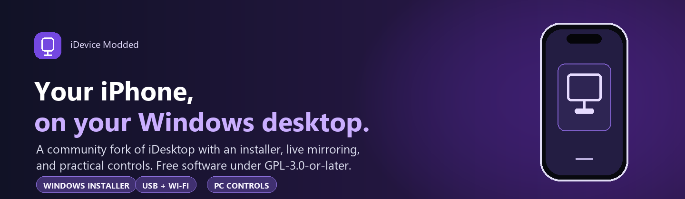

  

  <a href="https://github.com/kevinW0W/iDevice-Modded/releases/latest">Download for Windows</a>
  ·
  <a href="Others/README.md">Full guide</a>
  ·
  <a href="Others/Q_A.md">Troubleshooting</a>

# iDevice Modded

An attributed community fork of [realxhabib/iDesktop](https://github.com/realxhabib/iDesktop).
Mirror and control your iPhone from a Windows desktop using USB or Wi-Fi.

> **Compatibility:** The Windows installer is **64-bit only**. HD mirroring requires iOS 27 or
> newer and a compatible HEVC decoder. See the [full guide](Others/README.md#requirements) for
> setup details and the [troubleshooting guide](Others/Q_A.md) for common issues.

## Download

Get the latest installer from [GitHub Releases](https://github.com/kevinW0W/iDevice-Modded/releases/latest).
The release page contains the Windows setup executable and release notes.

The installer offers Start Menu and desktop shortcuts, installs to Program Files, and includes
uninstall support. It detects compatible 64-bit Python 3.13 or can install its bundled runtime;
application dependencies are included for offline installation.

## Features

- Live iPhone screen mirroring and mouse, touch, and keyboard controls.
- USB connection, with Wi-Fi available after pairing.
- Floating phone window, full-screen view, screenshots, audio, and clipboard sync.
- iPhone 12-style notch and Dynamic Island-style mirror overlays, with a hide option.
- Optional WebDriverAgent support for automation features and Lite-mode fallback where supported.

## What's added and improved

- Branded Windows installer with embedded artwork, purple progress, shortcuts, and uninstall.
- Start Menu and desktop shortcuts launch the installed `iDesktop.bat` entry point.
- Startup splash with app preview, live startup log, and rounded progress indicator.
- Clearer issue templates and a detailed troubleshooting guide.
- Improved phone-frame alignment and remembered notch selection, with a notch overlay that stays aligned in floating mode.
- “Sound on PC only” now lowers phone volume without a final volume-up press. iOS may also mute
  mirrored PC audio when the phone volume is zero.

## WebDriverAgent

For optional Automation, download the [unsigned WebDriverAgent 16.12.8 IPA](https://github.com/kevinW0W/iDevice-Modded/releases/download/v0.1.0/WebDriverAgent-16.12.8-unsigned.ipa)
from the release and sideload it with your own Apple ID using [Sideloadly](https://sideloadly.io).
The IPA is unsigned by design; see the attached
[BSD-3-Clause license](https://github.com/kevinW0W/iDevice-Modded/releases/download/v0.1.0/WebDriverAgent-BSD-3-Clause-LICENSE.txt).
The [full guide](Others/README.md#optional-extra-webdriveragent) also explains how to generate it
locally.

## Documentation and support

- [Full guide: installation, setup, and controls](Others/README.md)
- [Troubleshooting FAQ](Others/Q_A.md)
- [Report a bug](https://github.com/kevinW0W/iDevice-Modded/issues/new?template=bug_report.yml)
- [Share a working setup](https://github.com/kevinW0W/iDevice-Modded/issues/new?template=works_on_my_setup.yml)

## Attribution and license

This is a community fork of [realxhabib/iDesktop](https://github.com/realxhabib/iDesktop).
Original authors and contributors retain credit for their work. The project is distributed under
the [GNU GPL-3.0-or-later](Others/LICENSE).
